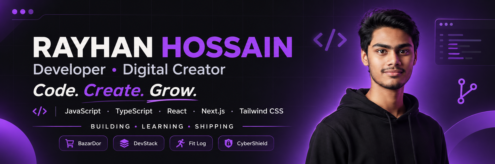

<!-- ═══════════════ HEADER / BANNER ═══════════════ -->
<div align="center">



<br/>

<a href="https://github.com/rayhanhossain-pro">
  
</a>

<br/>


</div>

<br/>

<!-- ═══════════════ ABOUT ME ═══════════════ -->
## 👨‍💻 About Me

```js
const rayhan = {
  name: "Md Rayhan Hossain",
  role: "Full-Stack Developer & Digital Creator",
  education: "CS Student (CST) @ Polytechnic Institute",
  location: "Dhaka, Bangladesh 🇧🇩",
  languages: ["বাংলা", "English"],
  currentFocus: "Next.js, TypeScript & Full-Stack Web Apps",
  motto: "Code. Create. Grow.",
};
```

I'm a second-year Computer Science student who loves turning ideas into real, shipped products. I build clean, responsive web apps, learn something new every week, and share the whole journey publicly. My goal is simple: **write better code, build useful things, and grow with the community.**

<br/>

<!-- ═══════════════ CURRENT ACTIVITY ═══════════════ -->
## 🔭 What I'm Up To

- 🚀 Building **BazarDor** — a Next.js app with authentication and a MongoDB backend
- 🌱 Deep-diving into **Next.js (App Router)** and **TypeScript**
- 🧰 Crafting **DevStack Builder** — a tool to browse technologies and build your own stack
- 🎨 Polishing my **bilingual portfolio website** (English + বাংলা)
- 📈 Documenting my dev journey on **LinkedIn** — learning in public
- 🔐 Next on my roadmap: **Cybersecurity**, then **AI/ML**

<br/>

<!-- ═══════════════ SKILLS ═══════════════ -->
## 🛠️ Tech Stack & Skills

<div align="center">

**Languages**


**Frontend**


**Backend & Database**


**Tools & Deployment**


</div>

<br/>

<!-- ═══════════════ FEATURED PROJECTS ═══════════════ -->
## 🚀 Featured Projects

| Project | Description | Tech |
| :-- | :-- | :-- |
| 🛒 **BazarDor** | Market price tracker with auth and Figma-accurate UI | `Next.js` `Tailwind` `MongoDB` `BetterAuth` |
| 🧱 **DevStack Builder** | Browse technologies and build a personalized stack | `React` `TypeScript` `Vite` `Tailwind` |
| 🍽️ **Ember & Oak** | Six-page restaurant website with live clock, filtered menu & reservation popup | `HTML` `CSS` `JavaScript` `Bootstrap` |
| 📥 **MediaGrab** | Media downloader tool, deployed on Vercel | `React` `Vite` `Vercel` |

> 🔗 See everything on my [**repositories page →**](https://github.com/rayhanhossain-pro?tab=repositories)

<br/>

<!-- ═══════════════ GITHUB STATS ═══════════════ -->
## 📊 GitHub Stats

<div align="center">


</div>

<br/>

<!-- ═══════════════ CONTRIBUTION GRAPH ═══════════════ -->
## 📈 Contribution Activity

<div align="center">


</div>

<br/>

<!-- ═══════════════ TROPHIES ═══════════════ -->
## 🏆 GitHub Trophies

<div align="center">


</div>

<br/>

<!-- ═══════════════ SOCIAL LINKS ═══════════════ -->
## 🌐 Let's Connect

<div align="center">

<a href="https://www.linkedin.com/in/rayhanhossainofficial">
  
</a>
<a href="https://github.com/rayhanhossain-pro">
  
</a>
<a href="https://www.facebook.com/rayhanhossain.pro">
  
</a>
<!-- Add when ready:
<a href="mailto:YOUR_EMAIL">
  
</a>
<a href="https://YOUR-PORTFOLIO-URL">
  
</a>
-->

</div>

<br/>

<!-- ═══════════════ QUOTE + FOOTER ═══════════════ -->
<div align="center">

### 💬 "First, solve the problem. Then, write the code."

<br/>


⭐ *If you like my work, drop a star on my repos!* ⭐

</div>
